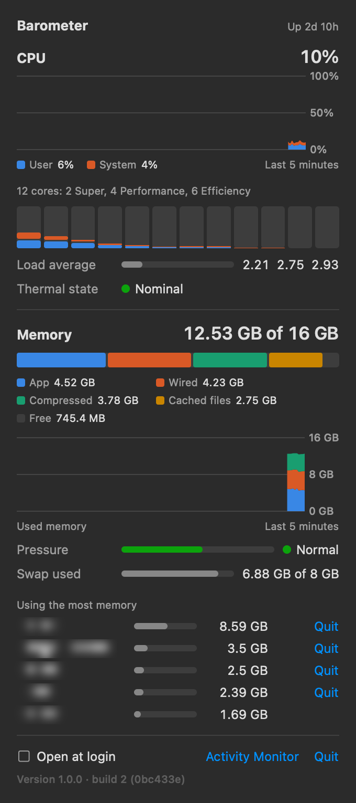
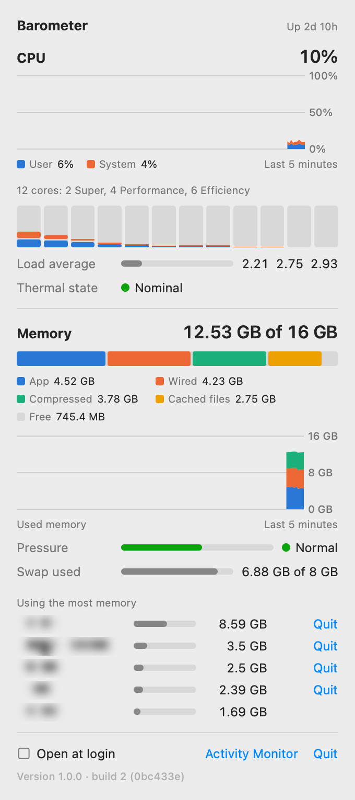

# Barometer

A small native Mac app that puts CPU and memory in the menu bar, and reads memory the way macOS
itself does: by pressure, not by free pages.

The icon is two live bars, CPU on the left and memory in use on the right. Click it for a panel of
simple graphs: five minutes of history, load on every core, the memory breakdown, memory pressure,
swap, and the five apps holding the most memory, each with a Quit button.

<p>
  
  
</p>

## Why

"How much memory is free?" is the wrong question on a Mac. macOS keeps idle memory busy as file
cache, so a free page count reads near zero on a perfectly healthy machine: Node's `os.freemem()`
once reported 1.7% free on a Mac where the kernel counted 66% of memory as available. What says a
Mac is short of memory is **pressure**, which is what Activity Monitor graphs and what this app
puts in the menu bar, read from the same kernel counters, without a window or a tab switch.

## Requirements

- macOS 14 or later, on Apple silicon or Intel.
- The Swift compiler from Xcode or the Command Line Tools (`xcode-select --install`).

No Xcode project, no dependencies.

## Build and install

```
git clone https://github.com/ivdezine/barometer.git
cd barometer
bash build.sh --install     # -> ~/Applications/Barometer.app
open ~/Applications/Barometer.app
```

Without `--install` the app lands in `build/` (ignored by git). The build targets the Mac it runs on;
set `ARCH=x86_64` or `ARCH=arm64` to build for the other one. It stamps the release identity,
`Version 1.0.0 · build <commit count> (<short commit>)`, shown at the foot of the panel. A build
from uncommitted changes carries `-dirty` after the commit.

The app is signed ad hoc on your own Mac, so a build from source opens without a Gatekeeper prompt.

Tick **Open at login** in the panel to start it with the Mac.

## What the panel shows

Click the icon to open the panel. A click anywhere outside it (the desktop, another window,
another menu bar item) closes it, as does a second click on the icon.

Readings refresh every two seconds. Hovering a history graph shows the values at that moment in
its key; hovering a core bar, a breakdown segment or a row explains it.

**CPU**

- The headline is the whole machine's load, every core together.
- The history stacks **User** (apps, with low-priority work counted in) under **System** (the
  kernel working for them).
- One bar per core, user at the base with system stacked on it. On Apple silicon the caption names
  the clusters as macOS reports them, for example `12 cores: 2 Super, 4 Performance, 6 Efficiency`.
  Bars are not labeled by cluster because the kernel does not say which core belongs to which.
- **Load average**: threads running or waiting for a core over 1, 5 and 15 minutes. The meter is
  the 1 minute figure against the core count, so a full meter means every core is busy.
- **Thermal state**: Nominal, Fair, Serious or Critical. Anything above Nominal means macOS is
  slowing the CPU to shed heat.

**Memory**, split the way Activity Monitor splits it:

| Part | What it is | Kernel counter |
| --- | --- | --- |
| App | Memory apps have allocated | anonymous pages less purgeable |
| Wired | Memory the kernel has pinned | wired pages |
| Compressed | Memory squeezed to make room, at its compressed size | pages occupied by the compressor |
| Cached files | Recently read files, given up the moment an app needs room | file-backed plus purgeable pages |
| Free | Everything else | total less the above |

- The headline, **used**, is App plus Wired plus Compressed. Cached files are not used memory.
- The history stacks the three used parts against the Mac's total.
- **Pressure**: Normal, Warning or Critical, from `kern.memorystatus_vm_pressure_level`. The meter
  is the share of memory the kernel does not count as available (`kern.memorystatus_level`).
  Warning means macOS is compressing and swapping to keep up.
- **Swap used** against the swap files on disk. It stays high after a busy spell and only matters
  while pressure is above Normal.

**Using the most memory**: the five apps holding the most, largest first.

- Each figure is the app's physical footprint, the number in Activity Monitor's Memory column
  (and `top`'s MEM), which counts what macOS has compressed or written to swap for it. That is why
  the five can add up to more than the Mac holds while swap is in use.
- Helper processes count toward the app they work for, as macOS tracks it: Firefox's content
  processes toward Firefox, Chrome's renderers toward Chrome, Safari's WebKit processes toward
  Safari. Hovering a row says how many processes it covers.
- Processes with no app, such as `node` or a command line tool, are grouped by name and listed
  without a Quit button. So are macOS's own apps (Finder, the Dock, loginwindow, whose quit logs
  out).
- **Quit** asks the app to quit the way Command-Q does, so it can still ask to save. The first
  click turns the button into **Confirm**; a second click within four seconds quits. Nothing is
  ever force quit or killed.
- Other users' processes, WindowServer and the system daemons among them, cannot be read without
  administrator rights and are not listed.
- The list is read only while the panel is open (about 10 ms every two seconds), and once the
  moment it opens.

There is no button to "free" memory. Purging drops only cached files, which are not used memory
and come back on the next read, and swap shrinks on its own once pressure stays Normal. Quitting
what holds the memory is the fix that works.

Colors come from a categorical palette checked for color vision deficiency separation in both light
and dark mode. Status is always a dot beside a word, never color alone.

## Command line

```
Barometer.app/Contents/MacOS/Barometer --sample                # one reading as JSON
Barometer.app/Contents/MacOS/Barometer --snapshot /tmp/panel 30  # 30 seconds of readings,
                                                               # then panel-light.png and panel-dark.png
```

`--sample` is what the tests hold against `sysctl`, `vm_stat` and `top`; it includes the top memory
users with each one's largest process. `--snapshot` renders the panel without opening it, for
checking a change; the screenshots above were made with it.

## Check it is working

- Two bars appear in the menu bar and track the load; the tooltip and the accessibility label read
  `CPU 11%, memory 13.25 GB of 16 GB used, pressure warning` or similar.
- With another app in front, open the panel and click the desktop: the panel closes.
- The panel's figures agree with Activity Monitor's Memory tab (Memory Used, App, Wired,
  Compressed, Cached Files, Swap Used) and with `memory_pressure` in Terminal.
- Each app's figure is close to the sum of its processes in Activity Monitor's Memory column, and
  to `top -o mem`.
- In Activity Monitor, the app itself sits well under 1% of a core with the panel closed, since the
  process list is read only while the panel is open.

## Remove it

- **Pause**: Quit from the panel. Nothing keeps running.
- **Stop it starting at login**: untick Open at login. It unloads and removes
  `~/Library/LaunchAgents/com.ivdezine.barometer.plist`. Unticking from the copy launchd started
  leaves the job to lapse at logout rather than unloading it, because unloading would quit the app.
- **Uninstall**: quit it, untick Open at login, then delete `~/Applications/Barometer.app`. The app
  writes nothing else.

## Tests

```
node --test barometer.test.mjs
```

Needs Node 20 or later and nothing installed. Checks that memory comes from the kernel counters
and pressure (never free pages), that the CPU reader frees the kernel's buffer and survives counter
wrap, that the history matches the five minutes the panel claims, that the icon is a template
image, and that Open at login loads what it writes. For the top memory list it checks that figures
are physical footprint grouped by responsible app, that Quit is a graceful two-click quit offered
only to apps outside macOS itself with nothing ever killed, and that processes are read only while
the panel is open. It checks that a click outside the panel closes it, and that the build targets
the Mac it runs on. It then compiles the real app twice into temp folders: an Intel build, run
under Rosetta where Rosetta is installed, and a native build whose stamped identity it checks
before taking one reading and holding it against `sysctl` and `vm_stat`, and each listed app's
largest process against `top`'s MEM column. The build tests skip where `swiftc` is missing.

## License

MIT, see [LICENSE](LICENSE).
